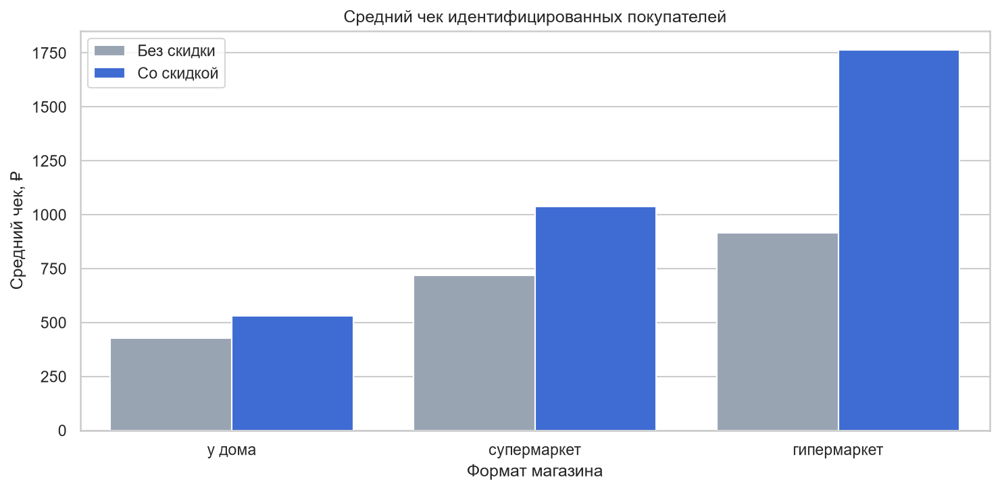
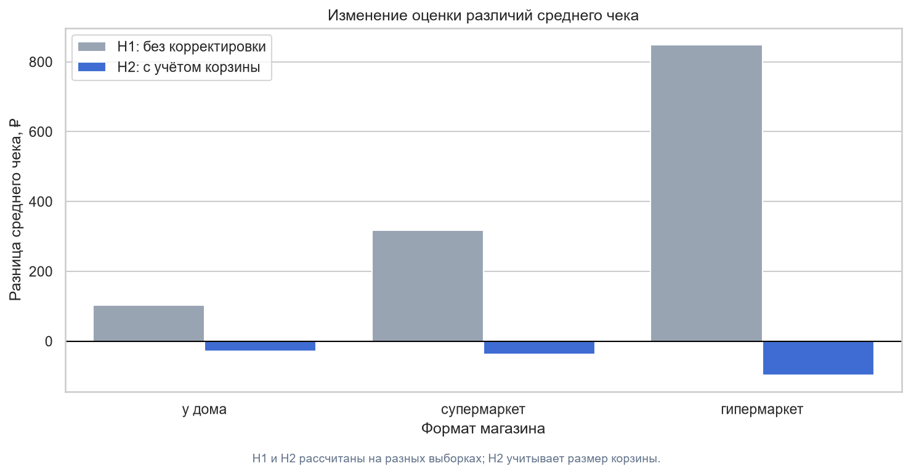
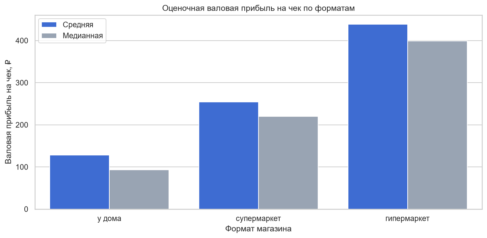

# Статистический анализ скидочной политики розничной сети «Соседушка»

**Python · pandas · SciPy · statsmodels · Статистический анализ · Ритейл**

## О проекте

**Бизнес-задача:** оценить, как наличие скидок связано с размером покупательской корзины, выручкой и валовой прибылью, и определить направления совершенствования скидочной политики розничной сети.

Первоначальный анализ показал, что скидочные покупки характеризуются более высоким средним чеком. Однако такой результат может быть связан не только со скидками, но и с различиями в количестве приобретаемых товаров.

Цель исследования — проверить наблюдаемые различия статистическими методами, учесть неоднородность форматов магазинов и размера корзины, а затем сформировать обоснованные рекомендации для бизнеса.

**Формат:** аналитический кейс на синтетических данных, приближенный к задачам коммерческой аналитики в ритейле.

## Данные

В исследовании использованы данные розничных продаж за 2024–2025 годы.

| Характеристика | Значение |
|---|---:|
| Товарных позиций | 81 238 |
| Уникальных чеков | 22 790 |
| Магазинов | 20 |
| Форматов магазинов | 3 |
| Товарных категорий | 14 |
| Уникальных товаров в справочнике | 101 |
| Период наблюдения | 24 месяца |

Исходная модель данных включает факты продаж и справочники товаров, магазинов, покупателей и поставщиков.

В ходе подготовки данных сформированы две аналитические выборки: на уровне товарной позиции и на уровне чека.

Основные показатели: выручка до и после скидки, сумма скидки, оценочная себестоимость, валовая прибыль, валовая маржа и размер покупательской корзины.

## Методология

Исследование выполнено на Python с использованием pandas, NumPy, SciPy, statsmodels, Matplotlib и seaborn.

Основные этапы:

1. Аудит качества данных: проверка ключей, пропусков, допустимых значений, финансовых расчётов и временного охвата.
2. Подготовка аналитических таблиц и расчёт финансовых показателей.
3. Разведочный анализ: средние, медианы, стандартные отклонения, квартили, асимметрия и потенциальные выбросы.
4. Анализ различий между форматами магазинов и размеров покупательской корзины.
5. Проверка шести статистических гипотез с оценкой значимости и размеров эффекта.
6. Формирование бизнес-рекомендаций и ограничений интерпретации.

Использованные статистические методы: t-критерий Уэлча, регрессия OLS с кластеризованными стандартными ошибками, критерии Краскела — Уоллиса, Манна — Уитни, χ² Пирсона, парный анализ изменений и корректировка множественных сравнений методом Холма.

## Ключевые результаты

### 1. Высокий средний скидочный чек не доказывает эффективность скидок

При первоначальном сравнении средний чек скидочных покупок оказался выше на 24–93% в зависимости от формата магазина.



Однако вероятность наличия хотя бы одной скидочной позиции увеличивается вместе с размером корзины. Следовательно, скидочные и нескиточные чеки не полностью сопоставимы.

### 2. После учёта размера корзины направление связи изменилось

Для дополнительной проверки построена регрессионная модель с учётом формата магазина и количества товарных позиций.

Анализ выполнен на 11 036 чеках, принадлежащих 4 400 идентифицированным покупателям.

| Формат | Исходная разница среднего чека | Скорректированная разница |
|---|---:|---:|
| У дома | +102,98 ₽ | −28,70 ₽ |
| Супермаркет | +317,57 ₽ | −37,94 ₽ |
| Гипермаркет | +849,37 ₽ | −97,27 ₽ |



Все три скорректированные разницы статистически значимы после поправки Холма (p < 0,05).

Важно: исходный и скорректированный анализы выполнены на разных выборках. Изменение оценок связано как с ограничением области сопоставимости, так и с учётом размера корзины. Результаты отражают статистические ассоциации, а не причинный эффект скидок.

### 3. Скорректированная валовая прибыль скидочных покупок также ниже

При использовании аналогичной регрессионной модели для оценочной валовой прибыли выявлены следующие различия:

| Формат | Скорректированная разница прибыли |
|---|---:|
| У дома | −30,65 ₽ |
| Супермаркет | −40,62 ₽ |
| Гипермаркет | −58,87 ₽ |

Все коэффициенты статистически значимы после поправки Холма.

Результат показывает, что более высокая абсолютная прибыль скидочных чеков при простом сравнении не является достаточным подтверждением экономической эффективности скидок.

### 4. Форматы магазинов существенно различаются



Средняя оценочная валовая прибыль на чек:

- Магазины у дома — 127,88 ₽.
- Супермаркеты — 253,88 ₽.
- Гипермаркеты — 438,80 ₽.

Критерий Краскела — Уоллиса выявил статистически значимые различия распределений (H = 6 284,93; p < 0,001; ε² = 0,2757). Попарные сравнения также обнаружили различия между всеми форматами.

Это обосновывает необходимость анализировать финансовые показатели с учётом торгового формата.

### 5. Дополнительные результаты

**Товарные категории.** Статистически значимой связи между категорией и частотой скидочных позиций не обнаружено (χ² = 10,75; p = 0,6318; V Крамера = 0,0155).

**Изменение между годами.** Среднее изменение оценочной валовой прибыли на чек при сопоставлении одинаковых магазинов и календарных месяцев составило +5,70 ₽ (p = 0,0121; 95% ДИ [+1,40; +9,99] ₽).

## Бизнес-рекомендации

**1. Изменить подход к оценке скидочной программы.** Использовать средний чек совместно с валовой прибылью, валовой маржой, размером корзины и эффективной скидкой. Оценивать результаты внутри сопоставимых покупательских групп.

**2. Провести дополнительный анализ магазинов у дома.** В этом формате скидочные чеки характеризуются наиболее выраженным снижением относительной маржи. Необходимо изучить глубину скидок, ассортимент и прибыльность всей корзины.

**3. Разделить аналитические ориентиры по форматам.** Не использовать единые абсолютные значения среднего чека и валовой прибыли для оценки разных форматов торговли.

**4. Не корректировать категорийную скидочную политику только по частоте скидок.** Необходимо дополнительно исследовать глубину дисконта и финансовый результат товарных категорий.

**5. Проверить причинный эффект скидок экспериментально.** Перед изменением скидочных условий провести контролируемый эксперимент с оценкой валовой прибыли на покупателя за фиксированный период.

## Ограничения исследования

- Данные синтетические, поэтому результаты не следует переносить на реальную торговую сеть без дополнительной проверки.
- Валовая прибыль рассчитана с использованием справочных закупочных цен без истории их изменения.
- Исследование наблюдательное и не устанавливает причинного влияния скидок.
- Регрессионные модели не контролируют полностью ассортиментный состав и индивидуальные особенности покупок.
- Часть статистических критериев не учитывает всю зависимость наблюдений внутри чеков и магазинов.

## Структура репозитория

```text
simulative-retail-discount-statistical-analysis/
├── data/
│   └── raw/
│       └── simulative_retail_sales.xlsx
├── notebooks/
│   └── retail_statistical_analysis.ipynb
├── reports/
│   └── figures/
│       ├── average_check_by_discount.png
│       ├── average_check_adjustment.png
│       └── gross_profit_by_format.png
├── requirements.txt
├── .gitignore
└── README.md
```

## Как воспроизвести анализ

Требуется Python 3.11. Проект проверен в Windows с использованием VS Code и PowerShell.

**1. Клонировать репозиторий**

```powershell
git clone https://github.com/mkudim/simulative-retail-discount-statistical-analysis.git
cd simulative-retail-discount-statistical-analysis
```

**2. Создать и активировать виртуальное окружение**

```powershell
py -3.11 -m venv .venv
.\.venv\Scripts\Activate.ps1
```

**3. Установить зависимости**

```powershell
python -m pip install -r requirements.txt
```

**4. Запустить исследование**

Открыть `notebooks/retail_statistical_analysis.ipynb` в VS Code, выбрать интерпретатор из `.venv` и выполнить все ячейки последовательно.

Исходный Excel находится в `data/raw/`. Путь к данным в Notebook задан относительно каталога `notebooks`.

## Итог

**Основной вывод исследования:** увеличение среднего чека скидочных покупок само по себе не подтверждает эффективность скидочной программы.

При оценке скидочной политики необходимо учитывать размер и состав покупательской корзины, валовую прибыль и особенности форматов магазинов. Для принятия решений об изменении скидок требуется дополнительная проверка их причинного влияния.

Подробный код, статистические проверки и интерпретации представлены в [Jupyter Notebook](notebooks/retail_statistical_analysis.ipynb).